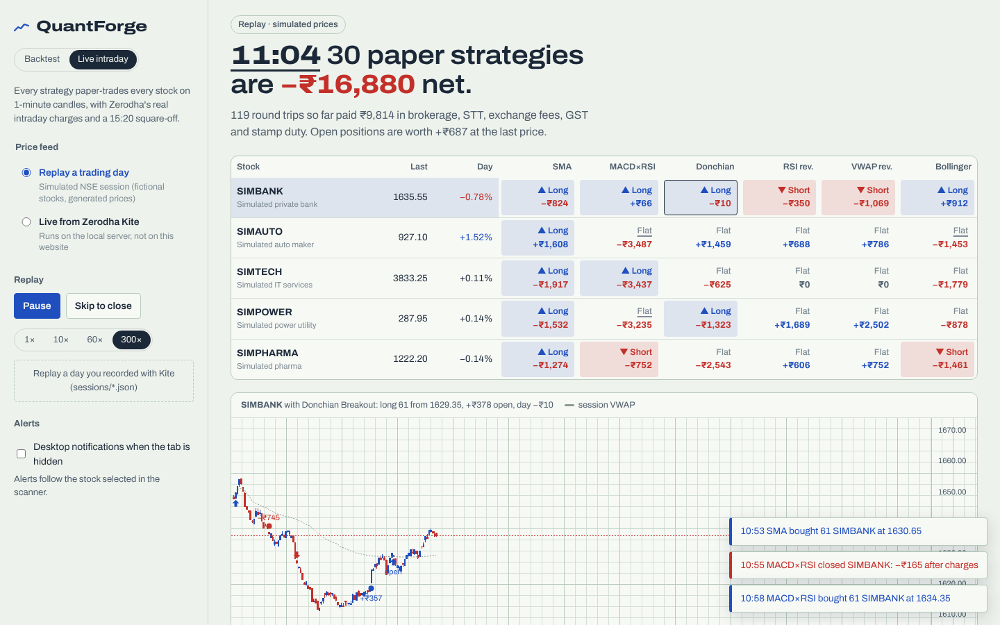

# QuantForge

Backtest a trading strategy without fooling yourself, then watch it paper-trade the market minute by minute.

**[Live intraday replay](https://sksiddhant.github.io/portfolio/quantforge/demo/#live)** · **[Backtester](https://sksiddhant.github.io/portfolio/quantforge/demo/)**, both run entirely in your browser.



## Live intraday mode

Connects to Zerodha Kite and runs six strategies on every stock in your watchlist at once, on 1-minute candles built from live NSE ticks.

- **Strategy scanner:** a stocks × strategies grid showing who is long, short or flat right now, with live P&L in each cell.
- **Real costs:** every round trip pays Zerodha's NSE intraday charges (brokerage, STT, exchange and SEBI fees, GST, stamp duty). The leaderboard shows how much of the gross profit they ate.
- **Honest timing:** a signal at a candle's close fills at the next minute's open, never on the candle that produced it. Everything is squared off at 15:20.
- **Alerts:** toasts and desktop notifications for fills on the stock you are watching.
- **Record and replay:** live mode saves every tick to `sessions/<date>.json`; load that file in the replay to re-run the day at up to 300×.
- **Paper trading only:** QuantForge never places orders.

The public demo replays a simulated session of fictional stocks through the same pipeline, so anyone can watch it trade without a Kite account.

### Run it with your Kite account

1. Create a Kite Connect app at [developers.kite.trade](https://developers.kite.trade) and set its redirect URL to `http://127.0.0.1:5000/kite/callback`.
2. Create `quantforge/.env` (git-ignored) with your keys:
   ```
   KITE_API_KEY=your_api_key
   KITE_API_SECRET=your_api_secret
   ```
3. Start the server and open http://127.0.0.1:5000:
   ```bash
   pip install flask numpy kiteconnect
   python -m quantforge serve
   ```
4. Go to **Live intraday → Live from Zerodha Kite**, log in, pick up to 10 NSE stocks and press **Start paper trading**.

Kite access tokens expire every morning, so log in once per day. If your app has historical-data access, the previous session's candles warm up the indicators at 9:15; without it they warm up from live candles.

## Backtesting


## What it does

- **Six strategies plus a benchmark:** SMA crossover, MACD × RSI, Donchian breakout, RSI mean reversion, VWAP reversion and Bollinger breakout, all compared against buy and hold.
- **Honest fills:** orders are decided at the close and filled at the next open. Brokerage and slippage are charged on every fill, and stop-losses trigger intrabar (a gap through the stop fills at the open).
- **Parameter map:** a heatmap of 144 backtests shows whether the edge is robust or one lucky setting.
- **Walk-forward:** tunes parameters on past data, then trades the next window it has never seen.
- **Monte Carlo:** replays the trades 1,000 times in random order to show the range of outcomes and drawdowns.
- **Your own data:** load any OHLCV CSV (NSE, Yahoo, TradingView). Results are reported in ₹.

## How it's built

```
quantforge/        Python engine: indicators, strategies, backtester, metrics, research tools, CLI, Flask API
quantforge/live/   tick aggregator, intraday runners, Zerodha cost model, Kite gateway, SSE stream
web/               React + Vite dashboard; web/src/engine and web/src/live are line-by-line JS ports
demo/         production build, served by GitHub Pages
tests/        pytest suite
```

The engine exists twice on purpose. The browser copy makes the demo instant with no server; the Python copy is the reference and runs the Kite feed. A parity suite runs both on 42 backtest configurations and on a full simulated trading day (every candle, signal, fill and trade), and requires them to match within 1e-9.

## Run it

```bash
pip install flask numpy
python -m quantforge strategies
python -m quantforge run --strategy donchian --market trending --stop 8
python -m quantforge run --strategy rsi_reversion --csv RELIANCE.csv --param period=6
python -m quantforge sweep --strategy vwap_reversion --market choppy
python -m quantforge walkforward --strategy sma_cross --market volatile
python -m quantforge serve        # dashboard + API on http://127.0.0.1:5000
```

When served by Flask, the dashboard can switch to the Python engine and shows that both engines agree.

Rebuild the dashboard:

```bash
cd web && npm install && npm run build
```

## Tests

```bash
pytest    # 60 tests: execution model, no look-ahead, costs, stops, metrics, API, candle aggregation,
          # next-open fills, 15:20 square-off, Zerodha charges, Kite login and stream (mocked),
          # Kite path gives the same trades as replay
python scripts/export_fixtures.py && cd web && npm test   # 8 tests: browser engines match Python
```

The look-ahead tests change future prices and assert the past never moves, and that the position held during a bar never depends on that bar's own prices. Planting a one-bar peek in the backtester fails them.

## Notes

The three sample markets come from a seeded regime-switching model, not real prices. This is a research tool, not investment advice.
