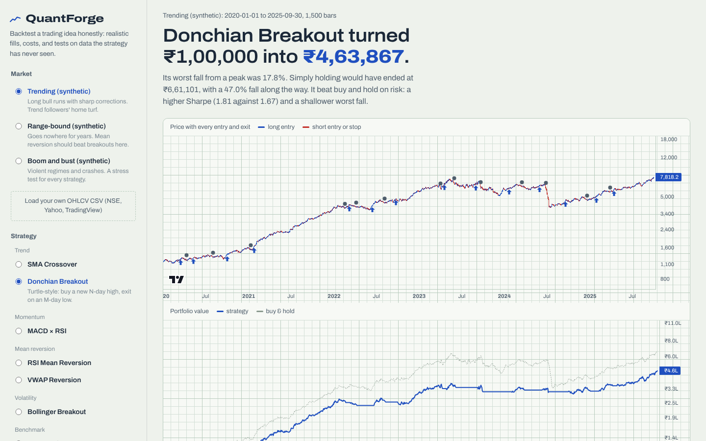

# QuantForge

Backtest a trading strategy without fooling yourself.

**[Live demo](https://sksiddhant.github.io/portfolio/quantforge/demo/)**, runs entirely in your browser.



## What it does

- **Six strategies plus a benchmark:** SMA crossover, MACD × RSI, Donchian breakout, RSI mean reversion, VWAP reversion and Bollinger breakout, all compared against buy and hold.
- **Honest fills:** orders are decided at the close and filled at the next open. Brokerage and slippage are charged on every fill, and stop-losses trigger intrabar (a gap through the stop fills at the open).
- **Parameter map:** a heatmap of 144 backtests shows whether the edge is robust or one lucky setting.
- **Walk-forward:** tunes parameters on past data, then trades the next window it has never seen.
- **Monte Carlo:** replays the trades 1,000 times in random order to show the range of outcomes and drawdowns.
- **Your own data:** load any OHLCV CSV (NSE, Yahoo, TradingView). Results are reported in ₹.

## How it's built

```
quantforge/   Python engine: indicators, strategies, backtester, metrics, research tools, CLI, Flask API
web/          React + Vite dashboard; web/src/engine is a line-by-line JS port of the Python engine
demo/         production build, served by GitHub Pages
tests/        pytest suite
```

The engine exists twice on purpose. The browser copy makes the demo instant with no server; the Python copy is the reference. A parity suite runs both on 42 market, strategy and config combinations and requires every equity value, trade and metric to match within 1e-9.

## Run it

```bash
pip install flask numpy
python -m quantforge strategies
python -m quantforge run --strategy donchian --market trending --stop 8
python -m quantforge run --strategy rsi_reversion --csv RELIANCE.csv --param period=6
python -m quantforge sweep --strategy vwap_reversion --market choppy
python -m quantforge walkforward --strategy sma_cross --market volatile
python -m quantforge serve        # dashboard + API on http://127.0.0.1:5000
```

When served by Flask, the dashboard can switch to the Python engine and shows that both engines agree.

Rebuild the dashboard:

```bash
cd web && npm install && npm run build
```

## Tests

```bash
pytest                          # 45 tests: execution model, no look-ahead, costs, stops, metrics, API
python scripts/export_fixtures.py && cd web && npm test   # 6 tests: browser engine matches Python
```

The look-ahead tests change future prices and assert the past never moves, and that the position held during a bar never depends on that bar's own prices. Planting a one-bar peek in the backtester fails them.

## Notes

The three sample markets come from a seeded regime-switching model, not real prices. This is a research tool, not investment advice.
